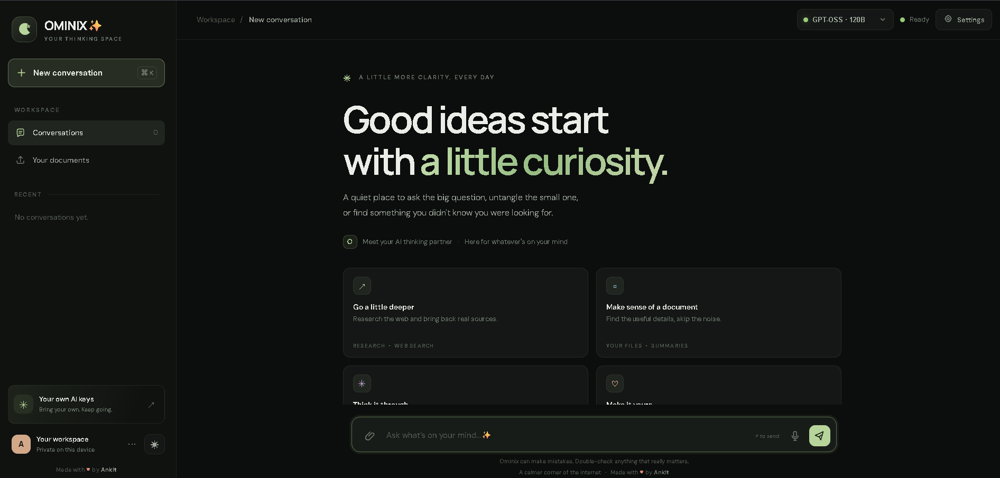

<div align="center">

# ***Ominix AI ✨***
---

### ***🤖 Agentic AI Workspace • Live Web Research • Document Intelligence • Persistent Memory***
***Multi-Model Chat • Source-Backed Answers • Bring-Your-Own Keys • Automatic Fallback • Dark Theme UI***

<p align="center">

</p>

<p align="center">


</p>

---

### ***🌟 About Ominix AI***

***Ominix is an agentic AI workspace built with LangGraph and LangChain. Instead of switching between separate apps for chatting, searching the web, summarizing documents and keeping notes, users get one calm "thinking space" where an AI agent decides which tool to use for each request.***

***It answers questions with live web research and real sources, makes sense of uploaded documents, remembers things worth keeping, and lets users choose between several fast open models running on Groq. Users can also bring their own API keys, with automatic fallback when the shared key hits a rate limit.***

<p align="center">
<a href="https://ominix-ai.onrender.com" target="_blank">

</a>
</p>
</div>

---

### ***🌐 Live Demo***

***Web Application 👉 [Ominix AI](https://ominix-ai.onrender.com)***

> ⏳ Hosted on a free tier, so the first load may take a few seconds while the server wakes up.

---

### ***📸 Project Preview***

<p align="center">

</p>

---

### ***✅ What Ominix AI Can Do***

- 💬 Chat-style AI thinking partner with multi-turn, context-aware conversations
- ⚡ Streaming responses powered by Groq inference
- 🤖 Choice of five models: GPT-OSS 120B, GPT-OSS 20B, Llama 3.3 70B, Llama 3.1 8B, Qwen 3 32B
- 🌐 Live web research that brings back real, cited sources
- 📰 Latest news, weather, stock and flight lookups through web search
- 📄 Document understanding: find the useful details and skip the noise
- 🧠 Personal memory: save something worth remembering for later
- 💡 Brainstorming: turn a knotty problem into a clear next step
- 🔑 Bring-your-own Groq and Tavily keys from the Settings panel
- 🔁 Automatic fallback to your personal key when the shared key is rate-limited
- 🗂 Conversations and documents workspace with a "New conversation" button
- ⌨️ Keyboard shortcuts (`⌘ K` for a new conversation, `↵` to send)
- 🌑 Modern dark-theme interface

---

### ***🧠 How It Works***

```text
                    💬 User Input
                          │
                          ▼
                1. Understand Intent
                          │
                          ▼
                2. LangGraph Agent
                   selects a tool
                          │
        ┌─────────────────┼─────────────────┐
        ▼                 ▼                 ▼
   🌐 Web Search      📄 Document AI     🧠 Memory
    (Tavily)           (summaries)     (saved context)
        │                 │                 │
        └─────────────────┼─────────────────┘
                          ▼
                3. Tool Execution
                          │
                          ▼
                4. LLM Reasoning (Groq)
                          │
                          ▼
         5. Streamed Answer with Sources
```

| Step | Stage | Purpose |
|---|---|---|
| 1 | **Understand intent** | Work out whether the question needs search, documents, memory or just chat |
| 2 | **Select tool** | The LangGraph agent routes the request to the right tool |
| 3 | **Execute tool** | Run web search, process a document or read/write memory |
| 4 | **LLM reasoning** | The chosen model combines tool output with the conversation context |
| 5 | **Final answer** | Stream the response, with sources when web research was used |

---

### ***🔑 Bring Your Own Keys & Automatic Fallback***

Ominix keeps working even when the shared quota runs out:

```text
Chat request
     ↓
Try shared Groq key
     ↓
Rate limit reached?
     ↓
 NO  → Respond normally
 YES → Retry with your personal Groq key
```

| Setting | What it does |
|---|---|
| **Your Groq API key** | Personal backup for AI chat |
| **Groq model ID (optional)** | Use any model available to your Groq account |
| **Your Tavily API key** | Enables live web research on your own search quota |

🔒 Personal keys are stored only in the browser tab's session storage and are never saved on the server. They can be removed at any time with **Remove my API keys**.

---

### ***💡 Example Prompts***

- *What are the latest developments in AI this week?*
- *Summarize this document and list the key action items.*
- *What's the weather like in Mumbai today?*
- *Help me break this project idea into clear next steps.*
- *Remember that I prefer concise answers with bullet points.*
- *How is the stock market doing today?*

---

### ***🧩 Tech Stack***

### ***AI & Agents***

- **LangGraph** for agent orchestration and tool routing
- **LangChain** for LLM and tool integrations
- **Groq** for fast inference (GPT-OSS, Llama, Qwen)
- **Tavily** for real-time web search
- **Persistent memory** for long-term user context
- **Document processing** for summaries and key-detail extraction

### ***Application***

- **Python 3.11**
- **Backend:** agent, tools and API layer
- **Custom dark-theme frontend:** HTML, CSS and JavaScript

### ***Deployment***

- **Docker**
- **Render**

---


### ***🧪 Why an Agentic Design Matters***

A plain chatbot answers everything from memory. Ominix decides what the question actually needs:

```text
Does the question need fresh information?
          ↓
   YES → Search the web and cite sources
   NO  → Is a document involved?
              ↓
       YES → Read and summarize the document
       NO  → Is it personal context?
                  ↓
           YES → Use or update memory
           NO  → Answer directly with the LLM
```

This keeps answers current, grounded and personal, without the user having to pick the tool.

---

### ***⚠️ Limitations***

- Free-tier hosting may have cold starts and non-persistent disk storage.
- The shared API key has rate limits; heavy use may require a personal key.
- Web research quality depends on search availability and source quality.
- Like any AI assistant, Ominix can make mistakes. Double-check anything that really matters.
- LLM and search services require network access and valid API keys.

---

### ***🔮 Future Enhancements***

- Voice assistant
- Image understanding
- RAG knowledge base
- Multi-agent collaboration
- Cloud memory sync
- Fully mobile-responsive UI
- User accounts and saved chat history across devices

---

### ***🎯 Real-World Use Cases***

✔ AI Assistant

✔ Research Assistant

✔ Web Search Assistant

✔ Document Summarizer

✔ Productivity Workspace

✔ Personal Knowledge Assistant

✔ Learning Companion

✔ Agentic AI Portfolio Project

---

## ***🧠 Key Learning Outcomes***

1. Build an agentic workflow with LangGraph and LangChain.
2. Route requests between web search, document, memory and calculator tools.
3. Integrate multiple open LLMs through Groq.
4. Add real-time web research with source-backed answers.
5. Implement persistent memory for personalized conversations.
6. Handle API rate limits with a bring-your-own-key fallback.
7. Stream responses to a custom dark-theme chat frontend.
8. Package the app with Docker and deploy it on Render.

---

## ***🔒 Privacy Note***

Ominix keeps the workspace private to the user's device. Personal API keys live only in the browser tab's session storage and are sent over a secure connection, never stored on the server.

---

## ***👨‍💻 Developer***

<div align="center">

# ***ANKIT GUPTA 👦***

### ***AI Engineer • AI Backend Developer • GenAI & Agentic AI Developer***

**Building practical AI systems with Python, LangGraph and LLMs**

</div>

---

### ***⭐ Support the Project***

If you find Ominix AI useful:

- ⭐ Star the repository
- 🍴 Fork the project
- 🐛 Report issues
- 💡 Suggest new features
- 📢 Share the project

---

<div align="center">

### ***Ominix AI: Your Thinking Space ✨***

***Think Smarter. Search Faster. Remember Better.***

### ***Built with ❤️ by Ankit***

</div>
